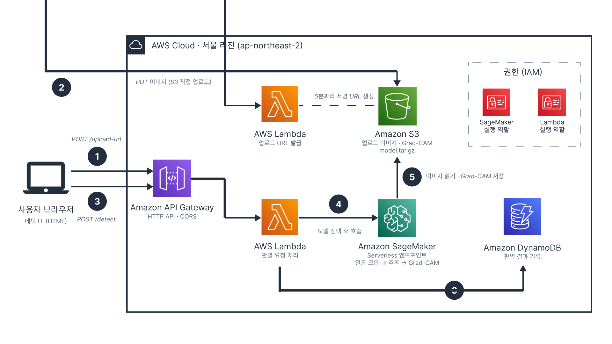

# Deepfake Detection Demo on AWS

날짜: 2026년 9월 28일
상태: 완료

---

> 얼굴 이미지를 업로드하면 선택한 모델이 딥페이크 여부를 판별하고, 판단 근거를 Grad-CAM 히트맵으로 보여주는 시연용 웹 앱입니다. 같은 이미지를 여러 모델로 번갈아 판별해 보며 개선 기법의 효과를 비교할 수 있습니다.
> 

## 비교 모델

| 모델 | 설명 |
| --- | --- |
| MoE-FFD | 기존 MoE-FFD (baseline) |
| Aug only | MoE-FFD + JPEG Augmentation (quality 30~70, p=0.5) |
| v4 | MoE-FFD + Phase 모듈: FFT 위상 정보를 Adapter MoE 라우팅에 활용하고, 학습 시 위상/공간 예측 간 consistency loss 적용 |
| Phase+aug | v4 구조 + JPEG Augmentation |

모든 모델은 ViT-B/16 기반이며, 단일 얼굴 이미지(224×224)를 입력받는 이미지 레벨 탐지 모델입니다.

## 사용 방법

<aside>

[deepfake_ui_aws.html](deepfake_ui_aws.html)

</aside>

1. 모델을 선택합니다.
2. 얼굴 사진(JPG, PNG, WEBP)을 업로드합니다.
3. Real / Fake 판정, Fake 확률, Grad-CAM 히트맵을 확인합니다.
4. 다른 모델을 선택해 같은 사진으로 다시 판별하고 결과를 비교합니다.

## 아키텍처



```
브라우저 (데모 UI)
  ├─ POST /upload-url ─▶ API Gateway ─▶ Lambda ─▶ S3 업로드용 임시 URL 발급
  ├─ PUT (이미지) ─────▶ S3 (브라우저가 직접 업로드)
  └─ POST /detect ─────▶ API Gateway ─▶ Lambda ─▶ SageMaker Serverless 엔드포인트
                                          │        (얼굴 크롭 → 모델 추론 → Grad-CAM)
                                          ├─▶ DynamoDB (판별 결과 기록)
                                          └─▶ S3 (Grad-CAM 이미지 저장)
```

| AWS 서비스 | 역할 |
| --- | --- |
| S3 | 업로드 이미지, 모델 파일, Grad-CAM 결과 저장 |
| API Gateway | 브라우저 요청을 받는 REST 엔드포인트 |
| Lambda | 업로드 URL 발급, 추론 요청 및 결과 저장 |
| SageMaker (Serverless Inference) | 4개 모델을 한 엔드포인트에 올려 선택형으로 추론 |
| DynamoDB | 판별 이력 저장 (job_id, 모델, 확률, 판정) |
| IAM | SageMaker, Lambda 실행 역할 |

모든 리소스는 서울 리전(ap-northeast-2)에 있습니다.

## 추론 과정

학습 데이터 전처리와 동일한 조건으로 추론합니다.

1. **얼굴 검출**: MTCNN으로 검출 후 신뢰도가 가장 높은 얼굴 선택 (신뢰도 0.9 미만, 40px 미만 얼굴 제외)
2. **크롭**: 얼굴 박스 기준 상하좌우 30% 여백 포함 → 224×224 resize
3. **정규화**: mean = std = [0.5, 0.5, 0.5]
4. **판정**: softmax의 Fake 클래스 확률이 threshold(0.5) 이상이면 FAKE
5. **Grad-CAM**: 마지막 Transformer 블록(`blocks.11.norm1`)의 패치 토큰 기준 히트맵 생성

얼굴이 검출되지 않으면 `NO_FACE`를 반환합니다.

## 모델 패키지

SageMaker 엔드포인트는 S3의 `model_v2.tar.gz` 하나를 받아 실행합니다.

```
model_v2.tar.gz
├── moe_ffd.pth, aug_only.pth, v4.pth, augphase.pth   학습된 가중치 4개
├── model_meta.json          모델 목록, 전처리 설정, 판정 기준
└── code/
    ├── inference.py         SageMaker 추론 스크립트
    ├── requirements.txt     timm==0.5.4, facenet-pytorch==2.5.3
    └── models/              모델 정의 코드
        ├── ViT_MoE.py                        (MoE-FFD, JPEG Aug only)
        ├── ViT_MoE_phase_consistency_v4.py   (Phase consistency)
        └── ViT_MoE_phase_aug.py              (Phase + JPEG Aug)
```

```bash
tar -czf model_v2.tar.gz -C model_package .
```

## API

**`POST /detect`**

```json
{ "jobId": "…", "key": "uploads/….jpg", "model": "v4" }
```

응답 예시:

```json
{  "model_name": "v4",  "face_found": true,  "fake_prob": 0.87,  "threshold": 0.5,  "verdict": "FAKE",  "gradcamUrl": "https://…"}
```

---

## 참고 사항

- Serverless 엔드포인트는 요청이 없으면 꺼져 있어 첫 요청이 느림. 시연 전 이미지 한 장으로 미리 워밍업해두기.
- 추론은 CPU 기준 이미지 한 장당 약 2초 소요.
- 시연 후에는 엔드포인트, Lambda, API Gateway, DynamoDB 테이블, S3 버킷을 삭제해 정리하기.